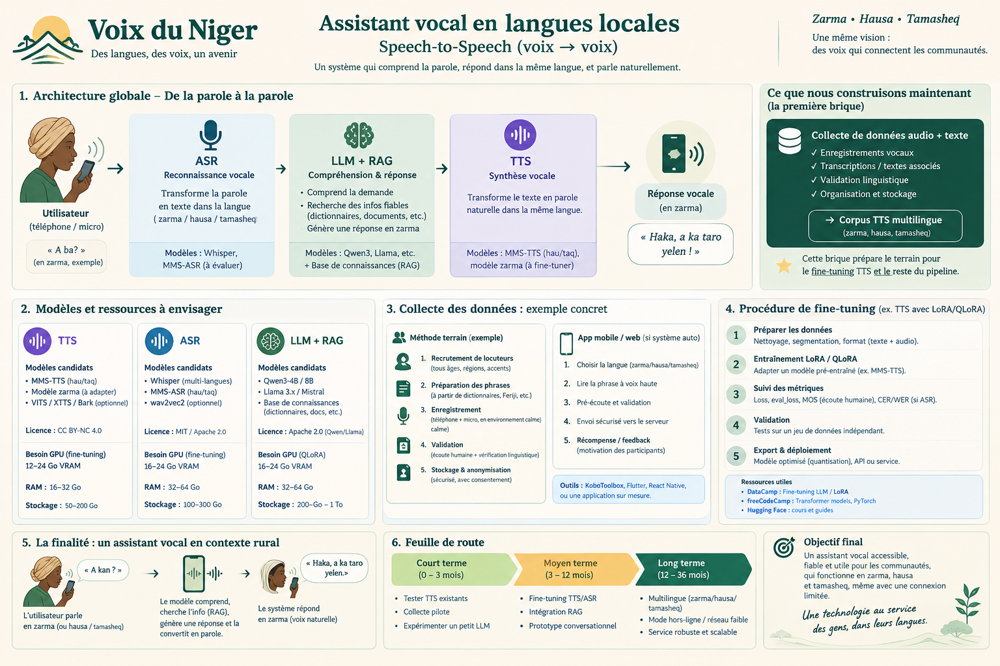

# De la collecte vocale à un assistant parlant zarma

Dernière révision : 2026-10-09

## 1. Comment s'appelle le produit visé ?

Le produit décrit (une personne dans un village parle en zarma à une application, puis entend une réponse prononcée en zarma) est un **assistant vocal conversationnel** (*conversational voice assistant*), plus précisément un **assistant de dialogue parlé** (*spoken-dialogue system*). Si le système reçoit de la parole et répond par la parole, on peut parler d'un pipeline **speech-to-speech (S2S)**. Il peut être implémenté avec plusieurs modèles en chaîne ou par un modèle speech-to-speech entraîné de bout en bout.

Pour Voix du Niger, une architecture modulaire est la voie la plus réaliste à court terme, parce qu'elle permet de mesurer chaque brique séparément et de remplacer un composant qui fonctionne mal.


## Schéma de synthèse

Le schéma ci-dessous présente la cible Speech-to-Speech, la place de la collecte actuelle et les phases de réalisation. Il s’agit d’une illustration de référence ; les modèles et besoins matériels sont des candidats à benchmarker, pas des choix validés.



**Finalité du projet :** un assistant vocal conversationnel multilingue. L’exemple agricole illustre un cas d’usage possible, mais l’objectif n’est pas limité à l’agriculture. La plateforme de collecte fournit maintenant deux parcours, avec validation par tâche. Le corpus et les modèles ASR/TTS doivent encore être constitués, entraînés et évalués séparément.

## 2. Architecture recommandée pour la première version

```text
Micro du téléphone
       │ audio Zarma
       ▼
ASR : parole → transcription zarma
       │ texte + score/indicateurs de confiance
       ▼
Orchestrateur
  ├─ détecte la langue/variante et le type de demande
  ├─ recherche des informations dans le RAG
  ├─ vérifie que les sources sont suffisamment pertinentes
  └─ applique les règles de sécurité et d'escalade
       │ contexte fiable + question
       ▼
LLM : réponse courte en zarma
       │ réponse textuelle
       ▼
TTS : texte zarma → audio zarma
       │
       ▼
Lecture sur le téléphone
```

La couche application gère aussi la fin de parole, les interruptions, le silence, les erreurs réseau, la répétition, la mise en file d'attente hors connexion et l'affichage facultatif du texte prononcé.

### Pourquoi ne pas entraîner directement un gros modèle speech-to-speech ?

Un modèle speech-to-speech de bout en bout doit déjà comprendre les langues en entrée et savoir les produire en sortie. Par exemple, Qwen3-Omni annonce de nombreuses langues texte, mais la liste officielle de ses langues d'entrée audio et de sortie vocale est beaucoup plus courte et ne comprend pas le zarma, le hausa ni le tamasheq parmi les langues vocales déclarées. Il serait risqué de croire que le seul mot « multilingue » suffit. Une architecture modulaire est plus contrôlable avec des langues à faibles ressources.

## 3. Où se trouve le projet actuel ?

**Le MVP actuel est la première brique de données et de qualité audio**, pas encore l'assistant vocal final.

| Élément | État actuel | Ce qu'il faut pour le produit final |
|---|---|---|
| Interface de collecte audio | MVP avec lecture guidée et mode spontané alimenté par consignes locales approuvées | Tests terrain, réseau faible, consentement final, retrait et décodage audio robuste |
| Corpus TTS | Les enregistrements lus peuvent être approuvés pour cette tâche | Prises propres et cohérentes, validées par langue et voix, avec droits vérifiés |
| Corpus ASR | Les audios lus peuvent être validés pour ASR ; la parole spontanée nécessite une transcription humaine vérifiée | Corpus diversifié, qualité de transcription, couverture des locuteurs et benchmark WER/CER indépendant |
| LLM répondant en zarma | Pas encore intégré | Modèle de départ mesuré, petit jeu de dialogue relu et éventuellement LoRA/QLoRA |
| RAG dictionnaire/agriculture | Pas encore intégré | Sources autorisées, documents structurés, moteur de recherche et tests de pertinence |
| TTS qui parle zarma | Pas de voix zarma validée | Benchmark de modèles, adaptation/entraînement et évaluation humaine de la prononciation |
| Application de terrain | Web de collecte, pas un produit conversationnel | Interface conversationnelle, mise en cache, mode connexion faible et stratégie hors ligne |

La même plateforme propose maintenant deux parcours : lecture guidée (potentiellement ASR et TTS après revue spécifique) et parole spontanée (ASR après transcription vérifiée). L'application ne contient aucun modèle ASR/TTS et n'exécute encore aucune inférence : elle collecte, fait annoter, valide et exporte les données. Le contenu de chaque langue doit d'abord être approuvé par des locuteurs compétents.

## 4. Une trajectoire réaliste en quatre étapes

### Phase 0 : vérifier la preuve de faisabilité (0–2 mois)

1. Constituer une petite liste de phrases de test par langue, revue par des locuteurs.
2. Télécharger et tester `facebook/mms-tts-hau` pour le hausa et `facebook/mms-tts-taq` pour le tamasheq ; tester `facebook/mms-tts-ses` uniquement comme comparaison exploratoire, sans l'appeler zarma.
3. Tester un petit LLM textuel (Qwen3-4B et, éventuellement, Gemma 3 4B) sur des conversations courtes en zarma, hausa et tamasheq. Les modèles capables d'une bonne performance en français/anglais peuvent échouer en zarma ; noter les erreurs et ne pas supposer la couverture.
4. Faire répondre le LLM à des questions en texte, d'abord sans RAG, pour établir un baseline.
5. Pour le zarma, faire écouter les sorties TTS à des natifs et identifier les sons/graphèmes mal prononcés.

**Livrable :** un tableau de benchmark, quelques fichiers audio d'essai, le coût par tâche et une décision argumentée par langue.

### Phase 1 : pilote d'un assistant en ligne (2–6 mois)

1. Collecter 10–20 heures de voix cible propre pour l'essai TTS si le budget le permet ; augmenter si l'évaluation indique que c'est insuffisant.
2. Collecter en parallèle des audios spontanés liés aux situations agricoles et faire transcrire les données par des annotateurs compétents. Viser d'abord un petit test puis élargir selon les erreurs ASR.
3. Créer une base de connaissances agricole à partir de sources fiables et autorisées : services de vulgarisation, recommandations nationales/locales, instituts de recherche, bulletins saisonniers et dictionnaires validés.
4. Développer une chaîne modulaire ASR → RAG/LLM → TTS, qui répond en phrases courtes. Quand l'ASR est incertain, demander à l'utilisateur de répéter ou de confirmer la transcription au lieu d'inventer.
5. Impliquer des agronomes ou agents de vulgarisation et des locuteurs natifs pour vérifier les réponses et leur formulation.

**Livrable :** prototype conversationnel avec un domaine limité (par exemple questions générales de culture), source des informations retrouvable et mesure des échecs.

### Phase 2 : fonctionnement en réseau faible / mode hors connexion (6–18 mois)

- Mesurer la taille et la latence de chaque composant quantifié.
- Précharger une base de connaissances essentielle et un index lexical sur le téléphone ou un appareil local.
- Mettre en cache les audio et permettre une file d'envoi différé pour l'annotation quand la connexion revient.
- Tester un TTS léger exporté ONNX/Piper s'il donne la qualité requise.
- Évaluer un LLM quantifié 1–4B sur les téléphones cibles ; la mémoire disponible, la vitesse de génération et la qualité en zarma peuvent limiter ce choix.
- Pour un mode entièrement hors ligne, l'ASR doit également tourner sur l'appareil et être validé. Si aucun ASR zarma local n'est assez bon, proposer un mode réduit (questions structurées, commandes simples, lecture de contenu préchargé) plutôt que prétendre à une conversation libre fiable.

**Livrable :** mode réseau faible avec fonctions hors ligne explicitement définies, temps de réponse mesuré et plan de synchronisation.

### Phase 3 : produit plus robuste (18–36 mois)

- Étendre le corpus avec plusieurs locuteurs, accents, âges adultes, contextes d'enregistrement et variantes orthographiques documentées.
- Construire des ensembles de test séparés par locuteur, thème et temps ; garder un test final que l'équipe n'utilise pas pendant le tuning.
- Comparer modèles indépendants, multilingues, LoRA/QLoRA et adaptation TTS spécifique à chaque langue.
- Organiser les versions du corpus, les audits de licence, les retraits et les sauvegardes.
- Établir un processus de maintenance du RAG pour que les recommandations périmées puissent être retirées ou mises à jour.
- Réaliser une évaluation terrain : utilisateurs comprennent-ils les réponses, savent-ils quand le système est incertain, et cela leur permet-il d'accomplir une tâche utile ?

## 5. À quoi sert un dictionnaire dans le RAG ?

Une base dictionnaire peut contenir : terme en langue locale, variantes, traduction(s), définition, exemple validé, catégorie grammaticale, dialecte/variante, système d'écriture, source, licence et responsable de validation. Elle peut aider à :

- rechercher le sens d'un mot agricole rare ;
- relier les variantes locales d'un terme à la même notion ;
- fournir au LLM une terminologie validée ;
- aider à expliquer des mots ou à normaliser des noms de cultures, d'insectes et de maladies ;
- signaler des variantes de traduction.

Mais **RAG et fine-tuning ne sont pas la même opération** :

- **RAG** : récupère les entrées pertinentes à chaque question, puis les donne au LLM dans le contexte. Le contenu peut être corrigé et mis à jour sans réentraîner le modèle.
- **Fine-tuning LoRA/QLoRA du LLM** : apprend des exemples de comportement ou de dialogues validés. Un simple dictionnaire ne suffit généralement pas à apprendre la conversation.
- **Fine-tuning ASR** : utilise des paires audio–transcription ; un dictionnaire seul n'entraîne pas la reconnaissance de la parole.
- **Fine-tuning TTS** : utilise des paires texte–audio correctement appariées ; un dictionnaire seul ne produit pas une voix.

### Pipeline RAG conseillé pour les langues à faibles ressources

1. Collecter seulement les dictionnaires et documents dont les droits d'utilisation sont clairs.
2. Nettoyer et structurer les entrées, tout en conservant la source, la licence, le dialecte, le script et la date.
3. Faire valider les termes et les variantes par des locuteurs/experts.
4. Commencer avec BM25 ou une recherche lexicale (SQLite FTS/PostgreSQL) et un dictionnaire de synonymes validé. Avec peu de données, cette base simple est souvent plus facile à tester qu'un système vectoriel uniquement dense.
5. En parallèle, évaluer des embeddings multilingues comme BGE-M3 ou multilingual-e5 sur un ensemble local de questions–documents. Ne pas supposer qu'un modèle d'embedding est performant en zarma parce que sa fiche indique « multilingue ».
6. Comparer précision/rappel du retrieval : le bon document apparaît-il dans les 3 ou 5 premiers résultats ? Faire noter le résultat par des locuteurs.
7. Utiliser une recherche hybride (lexicale + vectorielle) si elle améliore les résultats ; fournir au LLM les extraits récupérés et leurs sources.
8. Tester que les réponses restent fidèles aux sources, utilisent le zarma demandé et disent qu'elles ne savent pas lorsqu'aucune source pertinente n'est récupérée.

Pour des conseils agricoles, une base de dictionnaires ne suffit pas : il faut aussi des contenus techniques validés, des dates et des contextes géographiques. Le calendrier cultural, la pression de ravageurs ou les prévisions météo changent selon le lieu et la saison ; garder les faits dynamiques comme données à jour, pas comme une vieille réponse enfouie dans les poids du modèle.

## 6. Données à collecter séparément

| Corpus | Exemple | Utilisation |
|---|---|---|
| TTS lu, texte + audio propre | Une phrase préparée prononcée clairement par la voix cible | Apprendre à prononcer les réponses écrites |
| ASR spontané, audio + transcription exacte | Un agriculteur décrit son champ avec ses propres mots | Comprendre ce que l'utilisateur dit réellement |
| Dialogues validés, question + réponse zarma | Question utilisateur et réponse utile relue par un locuteur/expert | Adapter le LLM à la conversation et au style local |
| Base de connaissances | Dictionnaire, guide agronomique, bulletin daté, source/URL/licence | RAG : répondre sur des faits et retrouver la provenance |
| Évaluation tenue à l'écart | Requêtes et enregistrements non utilisés en entraînement | Mesurer la qualité sans fuite de données |

Les langues doivent avoir des tags explicites (`dje`, `ha`, `taq`) et des champs de dialecte/variante et de système d'écriture. Pour le tamasheq en particulier, choisir le système d'écriture avec la communauté visée et éviter de mélanger silencieusement des versions latine et tifinagh. Le hausa peut aussi inclure différentes conventions écrites ; documenter le choix.

## 7. Métriques pour le système complet

### ASR
- **WER** (Word Error Rate) et **CER** (Character Error Rate), calculés séparément par langue et par contexte.
- Taux d'erreur sur les noms propres, cultures, maladies, unités et nombres.
- Taux de demandes de clarification après une transcription incertaine.

### LLM / RAG
- Réussite de la tâche, exactitude factuelle validée par experts et qualité du zarma évaluée par locuteurs.
- Taux de réponse justifiée par une source correcte, pertinence du retrieval (Recall@k/MRR ou relevé manuel), taux d'hallucination.
- Taux de refus/clarification approprié et cohérence de la langue choisie.

### TTS
- Avis humain séparé sur l'intelligibilité, la prononciation, le naturel, l'adéquation de prosodie et la stabilité de voix.
- MOS (Mean Opinion Score) si le protocole de notation est correctement défini.
- WER/CER via un ASR externe seulement comme indice secondaire : si l'ASR est mauvais dans la langue, son score ne juge pas correctement le TTS.
- Temps de synthèse par seconde audio, pic VRAM/RAM, taux d'échec et taille du modèle.

### Conversation de bout en bout
- Latence de la fin de parole au début de la réponse parlée ; taux de tours terminés sans erreur ; demandes de répétition ; compréhension de l'utilisateur ; exactitude des conseils contrôlée par un expert ; consommation de données et fonctionnement en connexion faible.

## 8. Sécurité d'usage pour les conseils agricoles

- Les recommandations sur les pesticides, dosages, médicaments vétérinaires et sécurité ne doivent pas être inventées par le LLM.
- Afficher ou prononcer une source, sa date et le niveau de confiance pertinent ; si la base ne contient pas la réponse, demander confirmation ou orienter vers un agent de vulgarisation.
- Ne pas dépendre d'un dictionnaire pour diagnostiquer une maladie de plante ou d'animal.
- Prévoir un bouton/commande simple pour répéter, corriger une transcription, changer de langue ou parler à un conseiller humain.
- Évaluer avec des agriculteurs et agents de terrain avant toute recommandation utilisée pour une décision réelle.

## 9. Références principales

- Mozilla Common Voice : https://commonvoice.mozilla.org/
- TWB Voice / CLEAR Global : https://clearglobal.org/twbvoice/
- Ressources hausa de CLEAR Global : https://clearglobal.org/resources/hausa-synthetic-voice-dataset-tts-models-asr-models/
- Qwen3-Omni et couverture audio : https://github.com/QwenLM/Qwen3-Omni
- MMS-TTS Hausa : https://huggingface.co/facebook/mms-tts-hau
- MMS-TTS Tamasheq : https://huggingface.co/facebook/mms-tts-taq
- MMS-TTS Songhay/Koyraboro Senni : https://huggingface.co/facebook/mms-tts-ses
- MMS-ASR : https://huggingface.co/facebook/mms-1b-all
- Qwen3-4B : https://huggingface.co/Qwen/Qwen3-4B
- Piper : https://github.com/OHF-Voice/piper1-gpl
